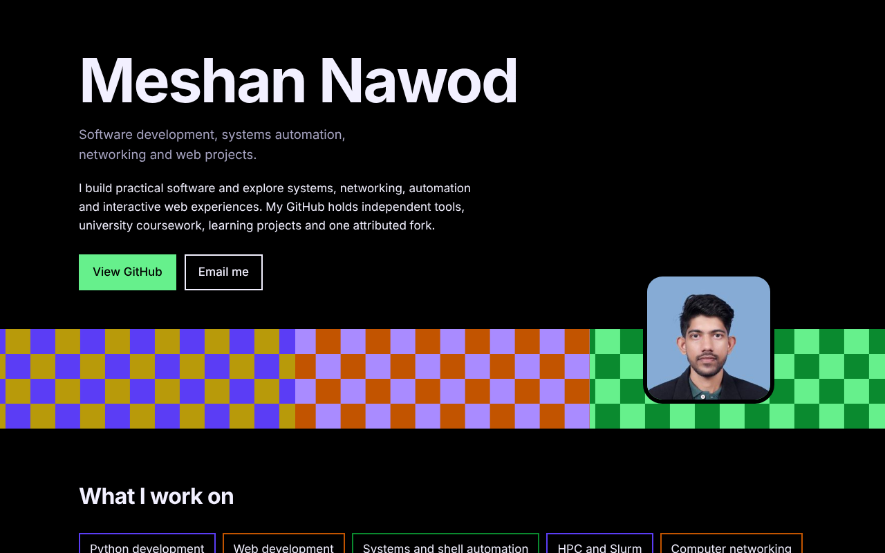

# Meshan Nawod · Portfolio (dark edition)

A one-page personal portfolio: software development, systems automation, networking and web projects.

  

> The main, up-to-date portfolio is **[meshannawod.github.io](https://meshannawod.github.io/)** ([source](https://github.com/MeshanNawod/MeshanNawod.github.io)). This repository keeps an alternative design.

## Run locally

Open `index.html` in a browser. It is a single static file with no build step.

## Author

Made by **Meshan Nawod**, Physics undergraduate at the University of Peradeniya · [Portfolio](https://meshannawod.github.io/) · [GitHub](https://github.com/MeshanNawod)
